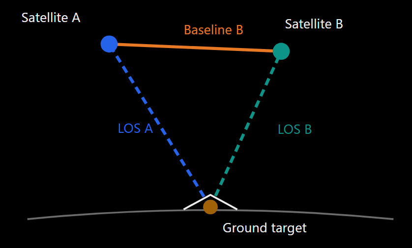
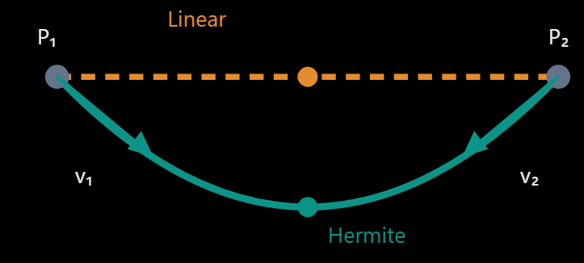

# ADR-007: InSAR Acquisition compatible interferometry

## Context

After check that all SAR adquisition are consistence for the analyze is necessary validate whether the acquisitions have sufficiently compatible observation geometries for interferometry.

The perpendicular baseline, (B_|_), measures the component of satellite separation perpendicular to the radar line of sight. Large perpendicular baselines can increase geometric decorrelation.

Importantly, the same relative orbit does not imply a zero perpendicular baseline.

**What is the perpendicular baseline?**
Two Sentinel-1 acquisitions observe approximately the same area from slightly different satellite positions.

The baseline vector joins the satelllite position.

Why it matters: A larger perpendicular baseline generally increases sensitivity to terrain height and can contribute to spatial decorrelation. However, there is no universal baseline threshold that guarantees usable coherence.

**How can the perpendicular baseline be calculate?**
To calculate the perpendicular baseline, we need:
- Satellite position vectors in a consistent Earth-centered coordinate reference system, usually ECEF.
- Precise acquisition timing and corresponding satellite positions.
- A ground target location or reference geometry.
- Orbit information, preferably from Sentinel-1 precise orbit products when available.

Sentinel-1 SLC products include orbit and timing metadata. Copernicus also distributes auxiliary orbit files, including precise orbit products (AUX_POEORB).

## Problem

The function inspect_orbit_metadata() don't give the information necesary  to calculate the perpendicular baseline (it does not contain the satellite position or velocity vectors).

## Solution

First gets the two earliest acquisitions based on acquisition time (select_earliest_acquisitions()).

Analyze the metadata from CDSE Products before download.

With the metadata is not possible get the position, velocity.

Next step is to get the orbit datas from the XML that is download from the SAR acquisition collection.

The burst time is: 18:10:48.641646
The two position before and after are:
1. Orbit timestamp: 2025-01-04T18:10:41354609, Position: {'x': 5675907.771652, 'y': -826917.154719, 'z': 4135035.0539}, Velocity: {'x': -4536.776735, 'y': -1093.048403, 'z': 5991.175203}
2. Orbit timestamp: 2025-01-04T18:10:51.354609, Position: {'x': 5630214.75706, 'y': -837767.84105, 'z': 4194712.175615}, Velocity: {'x': -4601.736726, 'y': -1077.052813, 'z': 5944.136954}
 
Time after first vector: 7.287 s
Time before second vector: 2.713 s

Once we have both vector (position and velocity) we calculate the interpolation.
Due to satellite don't travel in a straight line, it follows a cuved orbit a Cubit Hermite interpolation can appoximate the curved trayectory.

## How calculate the interpolation.

1. Find the surrounding state vector.

|State vector | Timestamp |
| --- | --- |
|First vector | 18:10:41.354609 |
|Acquisition | 18:10:48.641646 |
|Second vector | 18:10:51.354609 |

2. Normalize the time

$$u=\frac{t-t_1}{t_2-t_1}$$
$$u \approx \frac{7.287}{10}=0.7287$$

3. Calculate the Hermite basic functions
$$h00 = 2 * u**3 - 3 * u**2 + 1$$
$$h10 = u**3 - 2 * u**2 + u$$
$$h01 = -2 * u**3 + 3 * u**2$$
$$h11 = u**3 - u**2$$

4. Combine positions and velocities

$$
\boxed{
\mathbf{r}(t) =
h_{00}\mathbf{p}_1 +
h_{10}\Delta t\,\mathbf{v}_1 +
h_{01}\mathbf{p}_2 +
h_{11}\Delta t\,\mathbf{v}_2
}
$$

5. Calculate the perpendicular baseline.

We have two satellite positions:
$$\mathbf S_1=(X_1,Y_1,Z_1)$$
$$\mathbf S_2=(X_2,Y_2,Z_2)$$

Their difference is a baseline vector:
$$\mathbf B=\mathbf S_2-\mathbf S_1$$

But this is not yet the perpendicular baseline

For a common target P, define the unit line-of-sight (LOS) vector from the reference satellite toward the ground:
$$\hat{\mathbf l}=\frac{\mathbf P-\mathbf S_1}{\|\mathbf P-\mathbf S_1\|}$$

Then the perpendicular component of the baseline is:
$$\mathbf B_\perp=\mathbf B-(\mathbf B\cdot\hat{\mathbf l})\hat{\mathbf l}$$

Its magnitude is:
$$B_\perp=\|\mathbf B_\perp\|$$

6. Find these field for each point:

- azimuthTime
- slantRangeTime
- latitude, longitude, height
- line, pixel

| Field | January 4 | January 16|
| --- | --- | --- |
| Latitude | 36.969331940° | 36.969581823° |
| Longitude | −2.387762811° | −2.387520118° |
| Height | 720.954043 m | 720.954044 m |
| Line | 0 | 0 |
| Pixel | 0 | 0 |

The same pixel coordinates in two independently acquired SLC images do not necessarily represent the same ground target.

The images must be geometrically related before interpreting their phases or calculating target-specific baselines.

7. Define a common gorund target.

We now need to select one physical ground location P visible in both acquisitions.

The ground localition is is WGS84 (expressed as latitude, longitude and ellipsoidal height), we need to convert to ECEF (meters) using **pyproj**.

The result of convert is:

January 4
$$P1 = [5041796.14235344, -225830.47897671, 3888436.67298058]$$

Distance between the selected ground points
32.4 m