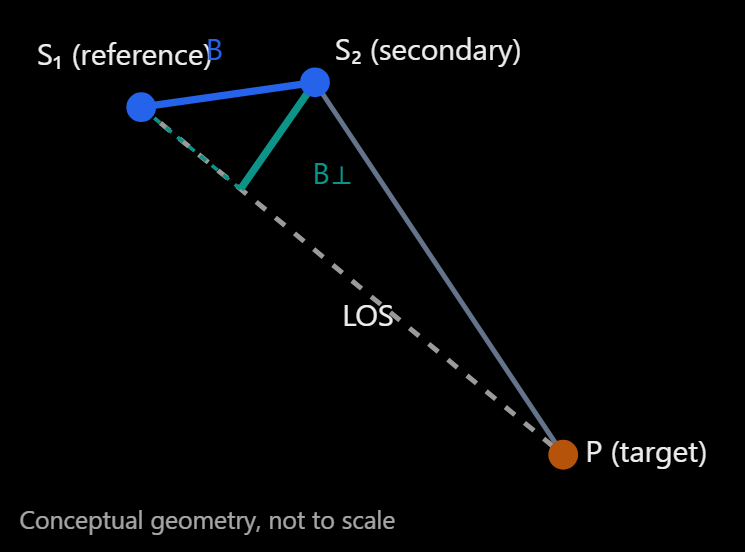

# ADR-006: InSAR perpendicular baseline

## Context

We have completed the essential geometric preparation:
- Selected two Sentinel-1A acquisitions, January 4 and January 16, 2025.
- Identified the same ground reference target in ECEF coordinates.
- Solved the zero-Doppler time for that target in each acquisition.
- Interpolated the corresponding satellite positions.
- Validated the zero-Doppler residuals.

Now we can calculate the perpendicular baseline, $$B_\perp$$ between the two satellite positions.

This is important because the perpendicular baseline affects interferometric sensitivity to topography and contributes to geometric decorrelation.

Let:
- S_1: reference satellite ECEF position, in metres.
- S_2: secondary satellite ECEF position, in metres.
- P: common ground target ECEF position, in metres.
All three vectors must use the same coordinate reference system.

## Solution

**Step A — Calculate the baseline vector**

$$
\mathbf B = \mathbf S_2-\mathbf S_1
$$

This is the displacement between the satellite positions at their respective zero-Doppler times for the same target.

**Step B — Calculate the reference line-of-sight unit vector**

Define the LOS direction from the reference satellite toward the ground target:
$$
\hat{\mathbf u}=
\frac{\mathbf P-\mathbf S_1}
{\|\mathbf P-\mathbf S_1\|}
$$

**Step C — Separate the parallel and perpendicular components**

The baseline component parallel to the LOS is:
$$
\mathbf B_\parallel =
(\mathbf B\cdot\hat{\mathbf u})\hat{\mathbf u}
$$

The perpendicular component is:
$$
\boxed{
\mathbf B_\perp =
\mathbf B-(\mathbf B\cdot\hat{\mathbf u})\hat{\mathbf u}
}
$$

Its magnitude is:
$$
\boxed{
B_\perp=\|\mathbf B_\perp\|
}
$$

This produces a nonnegative perpendicular-baseline magnitude in metres. A signed perpendicular baseline requires an additional, explicitly defined orientation convention.

That is implement with the function **calculate_perpendicular_baseline()**.

The calculation produced: 
- Total baseline: 21.652 m
- Parallel baseline: 18.123 m
- Perpendicular baseline: 11.848 m

We expect:
$$
B^2=B_\parallel^2+B_\perp^2
$$

Substituting your values:
$$
21.652086^2 \approx 18.123008^2+11.847761^2
$$

Both sides agree within the precision of your logged values.

This confirms that your baseline decomposition is internally consistent. It does not independently verify the accuracy of the orbit vectors, the ground target, or the zero-Doppler solutions.

A relatively small perpendicular baseline is generally favorable for interferometric coherence because it reduces geometric decorrelation.

## Validation