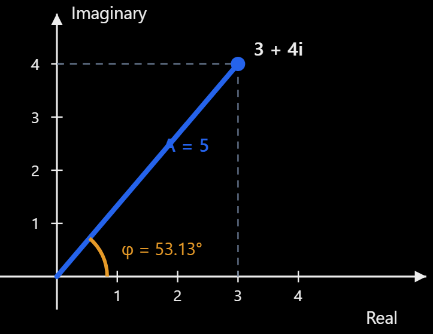

# ADR-009: Sentinel-1 TOPS SLC Coregistration

**Status:** Proposed  
**Date:** 2026-10-12  
**Scope:** Sentinel-1 IW3/VV SLC pair acquired on 2025-01-04 and 2025-01-16  
**Decision owner:** InSAR processing project

## 1. Context

Two single-look complex (SLC) images can have identical array dimensions without imaging the same ground resolution cell at matching indices. For example, a stationary target might appear at `(azimuth line, range sample) = (1000, 5000)` in the reference image and `(1002, 5001)` in the secondary image.

| Image | Target pixel (azimuth line, range sample) |
|---|---|
| Reference SLC | (1000, 5000) |
| Secondary SLC | (1002, 5001) |

Multiplying pixels at identical indices without coregistration,

$$
I(i,j)=S_{\mathrm{ref}}(i,j)S_{\mathrm{sec}}^*(i,j),
$$

would generally combine measurements from different ground resolution cells. The resulting phase is not a reliable interferometric measurement and coherence is typically reduced. Equal raster shapes or a common geographic CRS do **not** establish radar-image alignment.

Coregistration maps the secondary complex image onto the **reference radar sampling grid** so that corresponding output pixels represent the same ground resolution cell to the required accuracy. This is not simply reprojecting both SLCs to a common geographic CRS.

### 1.1 Complex-valued SLC measurements

An SLC sample can be written as

$$
S=Ae^{\mathrm{i}\phi},
$$

where $A=|S|$ is the amplitude and $\phi=\arg(S)$ is the phase. For example,

$$
S=3+4\mathrm{i},\qquad A=\sqrt{3^2+4^2}=5,
$$

$$
\phi=\operatorname{atan2}(4,3)\approx53.13^\circ.
$$

Consider two samples:

$$
S_1=3+4\mathrm{i},\qquad S_2=4+3\mathrm{i}.
$$

Both have amplitude 5, but their phases differ:

$$
\phi_1\approx53.13^\circ,\qquad
\phi_2\approx36.87^\circ,\qquad
\Delta\phi\approx16.26^\circ.
$$

Equal amplitude does not imply equal phase. This numerical example illustrates complex phase subtraction; it does **not** demonstrate ground displacement or successful coregistration.

### 1.2 Interferogram convention

After successful coregistration, we use the convention

$$
I(i,j)=S_{\mathrm{ref}}(i,j)
S_{\mathrm{sec,coreg}}^*(i,j).
$$

Therefore,

$$
\phi_{\mathrm{int}}=\arg(I)
=\operatorname{wrap}_{(-\pi,\pi]}
\left(\phi_{\mathrm{ref}}-\phi_{\mathrm{sec,coreg}}\right).
$$

The acquisition order and conjugation convention must remain consistent throughout phase modeling, deformation interpretation, and downstream products.

### 1.3 Why Sentinel-1 TOPS requires additional care

Sentinel-1 Interferometric Wide Swath (IW) TOPS acquisition steers the antenna in azimuth, producing a Doppler centroid that changes substantially across bursts. Small residual azimuth misregistrations can cause significant interferometric phase errors, including discontinuities in burst overlap regions.

A typical established TOPS workflow uses orbit/DEM-assisted geometric alignment, complex-valued resampling, and fine azimuth refinement such as Enhanced Spectral Diversity (ESD), when suitable overlapping burst data are available. Azimuth alignment on the order of $10^{-3}$ pixels is a commonly cited target, **not** a universal pass/fail criterion: the selected processor and acquisition geometry determine the actual tolerance.

## 2. Decision

1. Use the **2025-01-04** IW3/VV SLC as the reference radar geometry.
2. Coregister the **2025-01-16** IW3/VV secondary SLC to the reference geometry.
3. Use an established **Sentinel-1 TOPS-capable InSAR processor** for complex resampling and fine registration. The specific processor and version remain to be selected and recorded.
4. **Do not implement a custom complex-image resampler** in this phase.
5. Before coregistration, validate burst identity, image dimensions, time conventions, orbit-derived target coordinates, valid sample masks, and the actual availability of complex samples.
6. Accept the resulting registration only after inspecting residual offsets and TOPS burst-overlap phase behavior; metadata agreement alone is insufficient.

## 3. Rationale and alternatives

| Option | Assessment |
|---|---|
| Direct pixelwise multiplication | Rejected: identical array indices do not imply identical ground resolution cells. |
| Resample amplitude only | Rejected: discards the complex phase required for interferometry. |
| Resample phase as an ordinary scalar image | Rejected: wrapped phase cannot safely be treated as a conventional continuous scalar without special handling. |
| Build a custom complex SLC resampler | Deferred: high scientific validation burden, especially for TOPS Doppler effects and burst boundaries. |
| Established TOPS InSAR processor | **Selected approach:** mature geometric alignment, complex interpolation, and TOPS-specific fine-registration capabilities. |

## 4. Interferometric phase and topography

A nonzero interferometric phase does not by itself imply deformation. Before wrapping, a useful conceptual decomposition is

$$
\phi_{\mathrm{total}}=
\phi_{\mathrm{flat}}+
\phi_{\mathrm{topography}}+
\phi_{\mathrm{deformation}}+
\phi_{\mathrm{atmosphere}}+
\phi_{\mathrm{noise}}+
\phi_{\mathrm{residual}},
$$

with the observed phase

$$
\phi_{\mathrm{observed}}=
\operatorname{wrap}_{(-\pi,\pi]}(\phi_{\mathrm{total}}).
$$

The flat-Earth term reflects reference viewing geometry; the topographic term reflects elevation-dependent path differences; atmospheric terms represent propagation delays; and residual terms include imperfect processing and orbit/model errors. The exact decomposition depends on which corrections have already been applied. The deformation sign depends on the selected interferogram and line-of-sight conventions.

For a stationary target, $\phi_{\mathrm{deformation}}=0$ under a consistent deformation convention, while other contributions may remain nonzero.

The previously estimated perpendicular baseline is approximately **11.85 m** for this acquisition pair. This is an input estimate, not independently revalidated by this ADR. A nonzero perpendicular baseline makes terrain elevation relevant to interferometric phase. A DEM will be needed for geometric processing and for modeling/removing topographic phase in differential interferometry. A small baseline alone does not guarantee high coherence or negligible residual topographic phase.

## 5. Burst identity and sample validity

Sentinel-1 TOPS SLCs are organized into bursts. Their stored rectangular arrays may include lines and samples without valid radar measurements. Geographic burst footprints indicate approximate coverage but do not prove that a particular target has usable complex samples in both acquisitions.

### 5.1 Identification

The current candidate is:

| Field | Value |
|---|---|
| Subswath | IW3 |
| Polarization | VV |
| Catalogue burst ID | 219 |
| Annotation burst index | 3 (assumed zero-based) |
| Reference acquisition | 2025-01-04 |
| Secondary acquisition | 2025-01-16 |

**Important:** Catalogue burst ID `219` and annotation burst index `3` are distinct identifiers. Verify their mapping separately in each acquisition. Never describe index 3 as “annotation burst 219” without specifying the mapping.

### 5.2 Current validity statistics

| Metric | January 4 | January 16 |
|---|---:|---:|
| Catalogue burst ID | 219 | 219 |
| Annotation burst index (zero-based, to verify) | 3 | 3 |
| Validity-array entries | 1,516 | 1,516 |
| Lines with valid samples | 1,462 | 1,462 |
| Lines with no valid samples | 54 | 54 |
| Valid-line fraction | 96.44% | 96.44% |

The counts agree, but **matching counts do not imply matching valid regions**. The position of invalid lines and each line's valid range interval can differ. The 96.44% figure is a *fraction of lines with at least one valid sample*, not a fraction of valid pixels.

**Unresolved:** Confirm `linesPerBurst == 1516` from each product's annotation rather than inferring it solely from validity-array length.

### 5.3 Per-line valid sample test

For each acquisition, inspect `firstValidSample` and `lastValidSample`. In the usual annotation convention, `-1` denotes a line without valid samples. For a zero-based integer line $i$ and range sample $j$, require

$$
0\le i<N_{\mathrm{lines}},\qquad
0\le j<N_{\mathrm{samples}},
$$

and

$$
\operatorname{firstValidSample}[i]\ge0,\qquad
\operatorname{lastValidSample}[i]\ge
\operatorname{firstValidSample}[i],
$$

$$
\operatorname{firstValidSample}[i]\le j\le
\operatorname{lastValidSample}[i].
$$

Confirm the inclusivity of the annotation endpoints against the product specification and selected reader. For fractional coordinates, checking a single rounded pixel is insufficient if the interpolation kernel uses neighboring lines/samples. Validate the **full required interpolation support**, or rely on the selected processor's rigorously handled validity masks. Coregistration cannot reconstruct a measurement that was never validly acquired.

## 6. Geometry and target-coordinate calculations

The target is reported at latitude **37.69792639°**, longitude **−2.04381227°**. Calculations below assume that the target ECEF position and the orbit-derived zero-Doppler solutions are expressed in consistent terrestrial coordinates and time scales.

### 6.1 Annotation parameters

| Parameter | Reported value | Interpretation |
|---|---:|---|
| `azimuthTimeInterval` | 0.0020555563 s | Approx. 2.056 ms between adjacent azimuth lines |
| `slantRangeTime` | 0.0060170991 s | Two-way time to the first range sample, under the assumed convention |
| `rangeSamplingRate` | 64,345,238.13 Hz | Approx. 64.35 MHz |

**Unresolved:** Confirm these values independently in **both** annotation files and verify their definitions and image-sampling conventions. They are treated as shared inputs for the calculations below, not as proof of identical acquisition metadata.

### 6.2 Fractional range sample

For geometric slant range $R$, light speed $c=299\,792\,458\ \mathrm{m/s}$, first-sample two-way slant-range time $t_0$, and range sampling frequency $f_s$:

$$
j=\left(\frac{2R}{c}-t_0\right)f_s.
$$

This yields a **fractional zero-based sample coordinate**, provided that $t_0$ and $f_s$ describe the same radar image grid and that no extra sample offset applies.

| Acquisition | Orbit-derived slant range | Calculated range sample |
|---|---:|---:|
| January 4 | 931,409.419969 m | 12,649.9977 |
| January 16 | 931,391.297036 m | 12,642.2181 |

The secondary-minus-reference difference is approximately **−7.7795 range samples**. Different image coordinates are expected from different satellite viewing geometries; the difference alone is not evidence of bad data or successful registration.

**Next check:** Compare each computed coordinate with its annotation/geolocation-grid range coordinate, image width, and valid sample boundaries. Do not round until the chosen pixel/indexing convention and interpolation support are established.

### 6.3 Burst-relative azimuth coordinate

Let $t_{\mathrm{ZD}}$ be the target's zero-Doppler timestamp, $t_{\mathrm{burst,start}}$ the burst's first-line zero-Doppler timestamp, and $\Delta t_{\mathrm{az}}$ the azimuth line interval. Then

$$
i_{\mathrm{local}}=
\frac{t_{\mathrm{ZD}}-t_{\mathrm{burst,start}}}
{\Delta t_{\mathrm{az}}}.
$$

This formula is conditional on the annotation's `azimuthTime` field representing the first line's zero-Doppler time. Verify this convention before applying it.

For `linesPerBurst = 1516`, valid zero-based line indices are $0$ through $1515$. The elapsed time from the first to last line timestamp is

$$
(1516-1)\times0.0020555563\ \mathrm{s}
\approx3.1141688\ \mathrm{s}.
$$

**Next check:** Extract the burst start time from annotation index 3 for each acquisition, compute each fractional $i_{\mathrm{local}}$, and compare with both burst bounds and the valid-sample mask.

### 6.4 Global-line consistency warning

For the January 4 reference, the geolocation grid and orbit calculation report the same azimuth timestamp:

| Parameter | Reported value |
|---|---|
| Acquisition | January 4, 2025 |
| Geolocation-grid azimuth time | 18:10:53.027970 |
| Orbit-derived zero-Doppler time | 18:10:53.027970 |
| Ground target | 37.69792639°, −2.04381227° |
| Reported global image line | 6064 |

The time agreement supports internal consistency, but is not independent validation of the complete radar geometry because the annotation and orbit solution use related satellite data.

**Potential boundary inconsistency:** If annotation index 3 is zero-based, bursts are concatenated without intervening lines, and each preceding burst has 1,516 lines, the burst's first global line is

$$
3\times1516=4548.
$$

Under these assumptions, global line 6064 corresponds to

$$
i_{\mathrm{local}}=6064-4548=1516,
$$

which is **one past the final valid zero-based line index**. This is a conditional warning, **not** proof that the target is invalid. The global line might refer to a geolocation-grid node rather than the target, the indexing convention may differ, or the assumed mapping may be wrong.

Resolve this by explicitly recording: (a) what point global line 6064 describes; (b) its indexing base; (c) the actual first global line of annotation burst index 3; and (d) the target's independently calculated fractional burst-local line.

## 7. Pre-coregistration validation requirements

The following are **required checks**, not already-completed results.

| Check | Acceptance criterion | Current state |
|---|---|---|
| Product identity | Correct reference and secondary acquisitions | Candidate pair identified |
| Subswath/polarization | IW3/VV in both products | Reported; verify files |
| Burst identity | Catalogue-to-annotation mapping correct for each product | Pending independent verification |
| Dimensions | `linesPerBurst`, image width, validity-array lengths consistent | 1,516 validity entries reported; width and `linesPerBurst` pending |
| Orbit/time convention | Compatible timestamps, frames, orbit coverage and interpolation | Reference timestamp agreement reported; full check pending |
| Range position | Fractional target range inside image bounds | Calculated; bounds pending |
| Azimuth position | Fractional burst-local line inside burst bounds | Pending; investigate line 6064 |
| Valid sample mask | Both acquisitions have valid samples at target and required interpolation support | Pending |
| Complex raster | Actual samples accessible and usable | Pending |
| Shared ground cell | Geometric correspondence established during coregistration | Not performed |

Do not equate successful metadata validation with successful interferometric coregistration.

## 8. Coregistration workflow and acceptance

1. Validate product, subswath, polarization, burst mapping, annotation metadata, and orbit coverage.
2. Confirm the common valid ground-area overlap and the target's usable complex samples in both bursts.
3. Prepare the selected processor's required orbit and DEM inputs.
4. Perform coarse orbit/DEM-assisted geometric registration and **complex-valued** secondary resampling onto the reference radar grid.
5. Perform the processor's TOPS-specific fine azimuth alignment (for example, ESD where applicable and supported by sufficient burst overlap).
6. Generate a diagnostic interferogram using the documented reference-times-conjugate-secondary convention.
7. Inspect residual range/azimuth offsets, overlap phase continuity, valid-data coverage, and coherence in suitable areas.
8. Record quantitative thresholds **from the selected processor and workflow**, including their units, measurement method, and limitations, before marking the registration accepted.

Coherence alone is not a proof of correct registration: decorrelation may result from temporal changes, vegetation, geometry, or noise. Conversely, metadata checks and a visually plausible interferogram are not sufficient to certify TOPS phase accuracy.

### 8.1 Acceptance record (to be completed)

| Measurement | Method / threshold | Result |
|---|---|---|
| Selected processor and version | Record exact version/configuration | Pending |
| Precise orbit and DEM inputs | Record source, coverage and versions | Pending |
| Residual range offset | Define processor-specific tolerance | Pending |
| Residual azimuth offset | Define TOPS-specific tolerance | Pending |
| Burst-overlap phase residual | Define measurement and acceptable behavior | Pending |
| Valid overlap / interpolation mask | No invalid input samples silently treated as valid | Pending |
| Coherence diagnostics | Report statistics and spatial patterns, not a universal threshold | Pending |

## 9. Consequences

**Benefits:** Scientifically defensible complex alignment; avoids custom TOPS resampling errors; enables subsequent interferogram generation and differential phase analysis.

**Costs and dependencies:** Requires a maintained TOPS processor, its supported orbit/DEM inputs, additional computational resources, and explicit quality-control outputs. Processor choice, configuration, and versions must be documented for reproducibility.

**Limitations:** Coregistration does not restore invalid acquisitions, guarantee temporal coherence, eliminate atmosphere/topography, or turn a wrapped phase difference directly into ground displacement.
