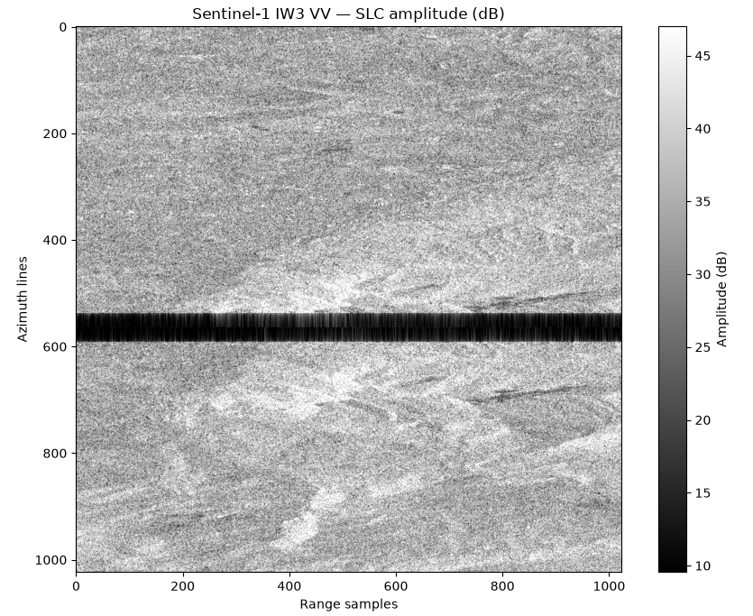

# ADR-009: InSAR coregistration

## Context

The visualization confirms that the reference SLC contains meaningful radar measurements. The image shows spatial backscatter variation, terrain-related structure, and a prominent dark horizontal band.

That dark band is the most important feature to understand before continuing.

**Gray, granular texture**

This is characteristic of SAR speckle. It arises from interference between radar echoes from multiple scatterers within a resolution cell.

**Brighter structures**

These indicate stronger measured radar amplitudes, potentially associated with terrain, surface roughness, or other scattering characteristics.

**Dark horizontal band near displayed rows 540–590**

This is consistent with a region of invalid or low-amplitude samples near a Sentinel-1 TOPS burst boundary. We should confirm it using the annotation's valid-sample masks rather than treating every dark pixel as invalid.

The visualization reads:
Window(
    col_off=12000,
    row_off=5500,
    width=1024,
    height=1024
)

Therefore, the dark band around displayed row 560 corresponds approximately to:
$$
5500+560=6060
$$

And from the annotation metadata:
$$
4\times1516=6064
$$

This is a significant consistency observation: the dark band is located near global line 6064, exactly where the next burst's fixed-size raster slot begins.

It also explains why the geolocation point at line 6064 can have a valid acquisition timestamp even though that particular raster location may be masked.

We now have evidence connecting the annotation burst layout with the actual TIFF.
