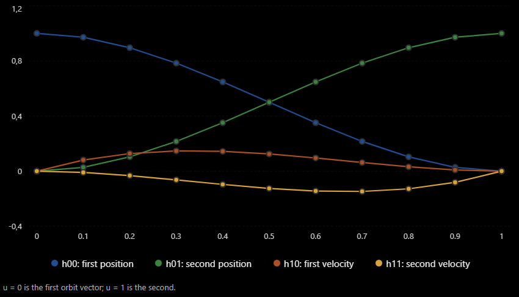
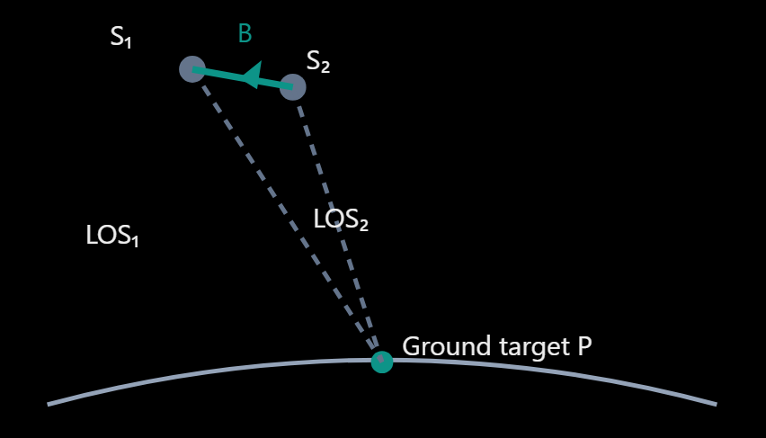

# ADR-007: Sentinel-1 InSAR Acquisition Geometry Compatibility

**Status:** Investigation in progress - baseline calculation and selected-burst mapping remain open  
**Scope:** Sentinel-1 SLC acquisitions of 4 and 16 January 2025  
**Purpose:** Establish whether two acquisitions observe a common ground target with valid radar samples, then calculate their perpendicular baseline.

> **Evidence note:** Numerical results below are reproduced from the original investigation, not independently recalculated. Statements labelled **Verified in reported tests** mean that the source document reports a passing diagnostic; they do not imply an independent code review.

## 1. Executive summary

Two acquisitions from the same relative orbit can have different satellite positions and therefore a nonzero perpendicular baseline. To assess interferometric compatibility, we must identify the **same physical ground target**, reconstruct each satellite's state at the appropriate observation time, verify that the target is recorded in valid radar samples, and calculate the baseline relative to its line of sight.

The investigation has established the following:

| Check | Reported finding | Status |
| --- | --- | --- |
| Obtain orbit position and velocity | Available in Sentinel-1 annotation orbit vectors | Completed |
| Interpolate satellite state | Cubic Hermite method described | Method established; numerical interpolation not independently checked |
| Find observation time for a common target | Zero-Doppler roots found for both acquisitions | Verified in reported tests |
| Check coordinate-frame consistency | Five-point derivative agrees with supplied velocity to about 0.8 mm/s | Verified in reported tests |
| Check full-image slant-range coverage | Estimated pixels 12650.001 and 12642.221 are in range | Verified in reported tests |
| Check valid TOPS burst samples | Common target valid in annotation burst index 3 in both images | Verified in reported tests |
| Map annotation index to configured burst IDs 218–220 | Not established in source | **Open** |
| Calculate perpendicular baseline | Equations given; no final baseline value reported | **Open** |
| Decide interferometric suitability | Requires baseline and other quality checks | **Open** |

**Main conclusion:** The common target has valid samples in both annotation datasets, but this does **not** yet establish that the configured bursts correspond to those samples or that the image pair has acceptable interferometric coherence.

## 2. Context and problem

InSAR (Interferometric Synthetic Aperture Radar) compares radar observations of the same ground area acquired at different times. Before comparing phase measurements, the acquisitions must be geometrically compatible and correctly aligned.

The existing `inspect_orbit_metadata()` function does not expose the satellite position and velocity vectors required to compute a perpendicular baseline. CDSE product-level metadata alone was insufficient for this calculation. The investigation therefore uses orbit state vectors and timing information from the Sentinel-1 SLC annotation XML.

The initial selection uses `select_earliest_acquisitions()` to choose the two earliest acquisitions by acquisition time. **Chronological selection is not a guarantee of geometric suitability.**

### 2.1 What is the perpendicular baseline?

Let $\mathbf S_1$ and $\mathbf S_2$ denote satellite positions at their respective observation times for a **common** ground target $\mathbf P$. Their separation is the baseline vector:

$$
\mathbf B=\mathbf S_2-\mathbf S_1.
$$

The perpendicular baseline is the component of this separation orthogonal to the reference line of sight (LOS). A large perpendicular baseline can increase sensitivity to terrain elevation and cause geometric decorrelation. No universal threshold guarantees usable coherence.

**Important:** Matching relative orbit numbers does not imply $B_\perp=0$.

### 2.2 Required inputs

- Satellite position and velocity vectors in a consistent coordinate system, typically Earth-centered, Earth-fixed (ECEF).
- Precise orbit-vector timestamps and acquisition timing.
- One common ground target with latitude, longitude, and **ellipsoidal** height.
- Sentinel-1 SLC annotation timing, range sampling, and burst-validity metadata.
- Preferably precise auxiliary orbit products (`AUX_POEORB`) when available and appropriate.

## 3. Method at a glance

1. Select candidate acquisitions and inspect their annotation XML.
2. Extract neighboring orbit state vectors and interpolate satellite position/velocity.
3. Select a common physical ground target and convert its coordinates to ECEF.
4. Solve each acquisition's zero-Doppler observation time for that target.
5. Check reference-frame consistency and solver residuals.
6. Confirm that the target is inside the recorded range interval.
7. Check the target's **valid sample mask** in a TOPS burst for each acquisition.
8. Resolve annotation burst indices to configured burst IDs.
9. Evaluate both satellite positions at their solved observation times and compute $B_\perp$.
10. Assess suitability using baseline and additional interferometric quality criteria.

## 4. Extract and interpolate orbit states

### 4.1 Example annotation vectors

For the 4 January acquisition, the source reports a target time of **18:10:48.641646 UTC** and two surrounding vectors:

| Quantity | First vector | Second vector |
| --- | --- | --- |
| UTC timestamp | 18:10:41.354609 | 18:10:51.354609 |
| Position X (m) | 5675907.771652 | 5630214.757060 |
| Position Y (m) | -826917.154719 | -837767.841050 |
| Position Z (m) | 4135035.053900 | 4194712.175615 |
| Velocity X (m/s) | -4536.776735 | -4601.736726 |
| Velocity Y (m/s) | -1093.048403 | -1077.052813 |
| Velocity Z (m/s) | 5991.175203 | 5944.136954 |

The original first timestamp contains a formatting typo (`18:10:41354609`); the table uses the consistent value `18:10:41.354609` reported elsewhere in the source.

The target time is approximately 7.287 s after the first vector and 2.713 s before the second.

### 4.2 Why cubic Hermite interpolation?

The satellite moves on a curved trajectory. **Cubic Hermite interpolation** uses both endpoint positions and velocities to approximate that trajectory between two known orbit states. Unlike simple linear interpolation, it matches the supplied endpoint velocities.

Let $t_1<t<t_2$, $\Delta t=t_2-t_1$, and normalize the time:

$$
u=\frac{t-t_1}{\Delta t}.
$$

For this example, $\Delta t=10\ \mathrm{s}$ and $u\approx0.7287$.

The Hermite basis functions are:

$$
\begin{aligned}
h_{00}(u)&=2u^3-3u^2+1,\\
h_{10}(u)&=u^3-2u^2+u,\\
h_{01}(u)&=-2u^3+3u^2,\\
h_{11}(u)&=u^3-u^2.
\end{aligned}
$$

The interpolated position is:

$$
\boxed{\mathbf S(t)=h_{00}\mathbf p_1+h_{10}\Delta t\,\mathbf v_1+h_{01}\mathbf p_2+h_{11}\Delta t\,\mathbf v_2}
$$

Here $\mathbf p_i$ are positions in metres and $\mathbf v_i$ are avelocities in m/s. Multiplying velocity by $\Delta t$ ensures all four terms have units of metres.

The interpolated velocity $\mathbf V(t)$ is obtained by differentiating $\mathbf S(t)$ with respect to time; it is needed for the zero-Doppler equation. Interpolation applies **inside** the orbit-vector interval; extrapolation beyond coverage requires separate handling.

## 5. Define a common ground target

Sentinel-1 geolocation-grid records include `azimuthTime`, `slantRangeTime`, `latitude`, `longitude`, `height`, `line`, and `pixel`.

An initial comparison of grid point `(line=0, pixel=0)` yielded:

| Field | 4 January | 16 January |
| --- | ---: | ---: |
| Latitude (degrees) | 36.969331940 | 36.969581823 |
| Longitude (degrees) | -2.387762811 | -2.387520118 |
| Height (m) | 720.954043 | 720.954044 |
| Line | 0 | 0 |
| Pixel | 0 | 0 |

These two grid points are approximately **32.4 m apart**. Identical pixel indices in separately acquired SLCs therefore do **not** necessarily identify the same ground target.

The initial investigation chooses the **4 January ground location** as the common target. Convert its WGS 84 geodetic latitude, longitude, and ellipsoidal height to ECEF coordinates using a suitable transform (for example, `pyproj`). The reported result is:

$$
\mathbf P=\begin{bmatrix}
5041796.14235344\\-225830.47897671\\3888436.67298058
\end{bmatrix}\ \mathrm{m}.
$$

**Clarification:** The later investigation selects a more interior geolocation-grid reference. Values for the initial point and interior point refer to **different target choices** and must not be mixed when computing a final baseline.

## 6. Find the zero-Doppler observation time

### 6.1 Physical condition

For a stationary target in the adopted Earth-fixed frame, the simplified zero-Doppler condition is that the target LOS and satellite velocity are perpendicular:

$$
\boxed{f(t)=[\mathbf P-\mathbf S(t)]\cdot\mathbf V(t)=0.}
$$

$\mathbf P$ and $\mathbf S$ have units of metres, $\mathbf V$ of m/s, and $f(t)$ of m²/s. The observation times need not match between acquisitions, even for the same target.

Initial residuals reported in the investigation were:

| Acquisition | Initial residual (m²/s) |
| --- | ---: |
| 4 January | +367633418.93 |
| 16 January | +225815737.49 |

A positive nonzero residual means that the evaluated state is not yet at the zero-Doppler time; it does not mean the acquisition is unusable.

### 6.2 Bracket and solve the root

The implementation uses `find_zero_doppler_brackets()` to find an interval in which $f(t)$ changes sign, then `solve_zero_doppler_time()` with `scipy.optimize.brentq` to find the root. Brent's method requires a continuous function and a valid sign-changing bracket.

| Acquisition | Bracket start (UTC) | Bracket end (UTC) | Start residual (m²/s) | End residual (m²/s) |
| --- | --- | --- | ---: | ---: |
| 4 January | 18:10:51.354609 | 18:11:01.354609 | +3825880971.955 | -3879060886.022 |
| 16 January | 18:10:50.367359 | 18:11:00.367360 | +3825130357.541 | -3879817001.537 |

The sign changes confirm that each reported interval brackets a root.

| Metric | 4 January | 16 January |
| --- | ---: | ---: |
| Solved zero-Doppler time (UTC) | 18:10:55.790539 | 18:10:54.788603 |
| Residual (m²/s) | -6.178624 | -17.171516 |
| Root within bracket | Yes | Yes |

These results refer to the **initial reference target**. Later interior-target and burst checks have different solved times; do not reuse these initial times with the interior target.

### 6.3 Evaluate the normalized residual

The raw residual depends on range and satellite speed. A dimensionless diagnostic is:

$$
r_{\mathrm{norm}}=\frac{|(\mathbf P-\mathbf S)\cdot\mathbf V|}{\|\mathbf P-\mathbf S\|\,\|\mathbf V\|}.
$$

This is the absolute cosine of the angle between LOS and velocity; zero means exact perpendicularity.

| Metric | 4 January | 16 January |
| --- | ---: | ---: |
| Raw residual (m²/s) | -6.178624 | -17.171516 |
| LOS distance (m) | 901940.459 | 901922.588 |
| Satellite speed (m/s) | 7593.923 | 7593.920 |
| Normalized residual | $9.02\times10^{-10}$ | $2.51\times10^{-9}$ |

These very small normalized residuals support numerical convergence. Converting floating-point root times into Python `datetime` values with microsecond precision can produce small nonzero residuals upon reevaluation.

## 7. Validate the coordinate reference frame

The zero-Doppler calculation assumes position and velocity are consistent with the chosen frame. In particular, do not mix Earth-fixed positions with inertial-frame velocities without applying the required frame transformation.

An empirical check compares the annotation velocity with a derivative estimated from neighboring Earth-fixed positions.

### 7.1 Three-point finite difference

$$
\mathbf V_{\mathrm{FD3}}(t_i)\approx\frac{\mathbf S(t_{i+1})-\mathbf S(t_{i-1})}{t_{i+1}-t_{i-1}}.
$$

| Metric | 4 January | 16 January |
| --- | ---: | ---: |
| Mean velocity difference | 0.147935 m/s | 0.147871 m/s |
| Maximum velocity difference | 0.148384 m/s | 0.148300 m/s |
| Relative mean difference | 0.00195% | 0.00195% |

### 7.2 Five-point finite difference

For uniformly spaced orbit vectors, a fourth-order accurate central derivative is:

$$
\mathbf V_{\mathrm{FD5}}(t_i)=\frac{\mathbf S(t_{i-2})-8\mathbf S(t_{i-1})+8\mathbf S(t_{i+1})-\mathbf S(t_{i+2})}{12\Delta t}.
$$

| Metric | 4 January | 16 January |
| --- | ---: | ---: |
| Maximum 3-point difference | 0.148384 m/s | 0.148300 m/s |
| Maximum 5-point difference | 0.000785 m/s | 0.000794 m/s |
| Reduction factor | ~189× | ~187× |

**Interpretation:** The five-point discrepancy is about 0.8 mm/s against a satellite speed of approximately 7594 m/s. The result strongly supports consistency between annotation velocities and derivatives of annotation positions. It is an empirical consistency check, not by itself a complete proof of the reference-frame metadata.

The source also names `test_annotation_velocity_consistency()` and `test_zero_doppler_time_within_annotation_coverage()` as validation tests. The latter's numerical output is not included.

## 8. Check slant-range geometry

### 8.1 Geometric range and radar travel time

For satellite position at the solved observation time:

$$
R=\|\mathbf P-\mathbf S(t^*)\|,\qquad \tau=\frac{2R}{c},\qquad c=299792458\ \mathrm{m/s}.
$$

Here $R$ is the one-way slant distance and $\tau$ is the two-way radar travel time. A distance around 902 km corresponds to approximately 6.02 ms.

For the **initial boundary reference point** on 4 January:

| Metric | Reported value |
| --- | ---: |
| Reference line / pixel | 7580 / 0 |
| Annotated azimuth time (UTC) | 18:10:55.790540 |
| Solved zero-Doppler time (UTC) | 18:10:55.790539 |
| Geometric slant range | 901940.459077 m |
| Equivalent range difference | -0.000234 m |

The 1 µs time difference and 0.234 mm equivalent range difference indicate strong agreement for this point. However, pixel 0 is at the near-range boundary, so the investigation moves to an interior target.

### 8.2 Interior reference point

`select_central_geolocation_point()` selects an interior geolocation-grid point. Its reported 4 January diagnostics are:

| Metric | Reported value |
| --- | ---: |
| Reference line / pixel | 6064 / 12650 |
| Annotated azimuth time (UTC) | 18:10:53.027970 |
| Solved zero-Doppler time (UTC) | 18:10:53.027970 |
| Geometric slant range | 931409.419969 m |
| Equivalent range difference | -0.000093 m |

**Note on coordinate conventions:** These are the geolocation-grid `line` and `pixel` values for the interior reference. A later calculation reports estimated **range-sample pixels** around 12650 and 12642. The original document uses the word *pixel* for both contexts; verify the mapping before treating them as interchangeable.

### 8.3 Actual recorded range coverage

Geolocation-grid coverage is not the same as the extent of the recorded radar samples. The annotation provides:

- `imageAnnotation/imageInformation/slantRangeTime`: two-way travel time for the first range sample.
- `imageAnnotation/imageInformation/rangePixelSpacing`: slant-range sample spacing in metres.
- `imageAnnotation/imageInformation/numberOfSamples`: number of range samples.

For zero-based range-sample index $j$:

$$
R(j)=\frac{c\tau_0}{2}+j\Delta R,\qquad 0\leq j\leq N-1.
$$

Thus the last sample has travel time:

$$
\tau_{\mathrm{last}}=\tau_0+\frac{2(N-1)\Delta R}{c}.
$$

The **$N-1$** term is essential because indexing starts at zero.

| Parameter | 4 January | 16 January |
| --- | ---: | ---: |
| First-sample two-way time | 0.006017099065 s | 0.006017099065 s |
| Slant-range sample spacing | 2.329562 m | 2.329562 m |
| Number of samples | 25286 | 25286 |
| First recorded range-sample indice | 0 | 0 |
| Last recorded range-sample indice | 25285 | 25285 |

Reported coverage: approximately **6.017099–6.410057 ms** for both acquisitions.

| Measurement | 4 January | 16 January |
| --- | ---: | ---: |
| Estimated range-sample pixel | 12650.001 | 12642.221 |
| Inside `[0, 25285]` | Yes | Yes |

The difference is $12642.221-12650.001=-7.780$ samples, or approximately **-18.12 m in slant-range coordinates**. This is **not** evidence of 18.12 m of ground displacement; geometry alone can shift the recorded range coordinate.

The source associates these diagnostics with `test_reference_target_within_range_samples()`.

## 9. Check TOPS burst coverage and sample validity

### 9.1 Why burst timestamps are insufficient

The processing configuration selects burst IDs **218, 219, and 220**. The annotation XML instead exposes a local `swathTiming/burstList/burst` sequence. **Do not assume configured burst IDs are zero-based annotation indices.** A separate mapping is required.

TOPS bursts overlap in azimuth time, but samples near burst boundaries can be invalid or zero-filled. Therefore, two separate conditions must hold:

1. **Nominal coverage:** The target's zero-Doppler time falls inside the burst time interval.
2. **Valid-sample coverage:** The target's estimated range sample is valid at the corresponding local azimuth line, according to `firstValidSample` and `lastValidSample`.

### 9.2 Annotation timing

| Parameter | 4 January | 16 January |
| --- | ---: | ---: |
| Lines per burst | 1516 | 1516 |
| Azimuth time interval | 0.0020555563 s | 0.0020555563 s |
| Annotation burst count | 9 | 9 |
| Index 0 start (UTC) | 18:10:41.991507 | 18:10:40.993083 |
| Index 1 start (UTC) | 18:10:44.758286 | 18:10:43.755751 |

Nominal burst duration is approximately:

$$
T_{\mathrm{burst}}=1516\times0.0020555563\approx3.1162\ \mathrm{s}.
$$

The source reports neighboring burst starts about 2.76 s apart, so their nominal windows overlap.

For the **interior target**, the relevant times are:

| Acquisition | Target zero-Doppler time (UTC) | Burst index 4 start (UTC) |
| --- | --- | --- |
| 4 January | 18:10:53.027970 | 18:10:53.027789 |
| 16 January | 18:10:52.026087 | 18:10:52.025254 |

The target is nominally inside burst index 4, but occurs almost at its beginning.

### 9.3 Calculate the local azimuth line

$$
\ell=\frac{t_{\mathrm{ZD}}-t_{\mathrm{burst,start}}}{\Delta t_{\mathrm{az}}}.
$$

The time offsets after index 4 starts are approximately 0.181 ms and 0.833 ms. This places the target close to local line zero, outside the valid-line region reported for burst index 4.

| Acquisition | Burst index | Valid local lines | Count |
| --- | ---: | --- | ---: |
| 4 January | 3 | 27–1488 | 1462 |
| 4 January | 4 | 29–1489 | 1461 |
| 16 January | 3 | 28–1489 | 1462 |
| 16 January | 4 | 28–1488 | 1461 |

The investigation consequently checks the overlapping **burst index 3**, including its per-line range validity.

### 9.4 Final reported valid-sample result

`test_reference_target_has_valid_burst_sample()` reports:

| Measurement | 4 January | 16 January |
| --- | ---: | ---: |
| Valid annotation burst | Index 3 | Index 3 |
| Local azimuth line | 1341.088 | 1342.405 |
| Nearest recorded line | 1341 | 1342 |
| Estimated range pixel | 12650.001 | 12642.221 |
| Valid range interval at target line | 298–23969 | 298–23969 |
| Sample validity | Passed | Passed |

**Conclusion:** The same ground target has a valid radar sample in annotation burst index 3 for both acquisitions. Although index 4 nominally covers the target time, the target's sample is invalid there. This validates annotation-level target coverage, **not yet** the mapping to configured IDs 218–220.

## 10. Compute the perpendicular baseline - remaining step

After choosing **one** common target and solving the corresponding observation time separately in each acquisition, evaluate the interpolated satellite positions:

$$
\mathbf S_1=\mathbf S_{\mathrm{Jan4}}(t_1^*),\qquad
\mathbf S_2=\mathbf S_{\mathrm{Jan16}}(t_2^*).
$$

Calculate the baseline vector:

$$
\mathbf B=\mathbf S_2-\mathbf S_1.
$$

Define the **reference** LOS unit vector pointing from satellite 1 to the target:

$$
\hat{\mathbf l}=\frac{\mathbf P-\mathbf S_1}{\|\mathbf P-\mathbf S_1\|}.
$$

Remove the baseline's component along the LOS:

$$
\boxed{\mathbf B_\perp=\mathbf B-(\mathbf B\cdot\hat{\mathbf l})\hat{\mathbf l}}.
$$

Its magnitude is:

$$
\boxed{B_\perp=\|\mathbf B_\perp\|}.
$$

This produces the **unsigned magnitude** of the perpendicular baseline. If a signed baseline is needed, the sign convention must be defined explicitly using the acquisition geometry and an orientation vector; it cannot be recovered from the magnitude alone.

**Not yet available in the source:** The two satellite positions evaluated for the **same final interior target** at their respective zero-Doppler times, and the resulting numerical $B_\perp$. No baseline value should be inferred from the range-coordinate shift or from the example orbit vectors alone.

## 11. Implementation and validation checklist

| Step | Function or diagnostic in source | Expected check | Reported status |
| --- | --- | --- | --- |
| Select candidates | `select_earliest_acquisitions()` | Chronological acquisition selection | Described |
| Inspect product metadata | `inspect_orbit_metadata()` | Detect missing state vectors | Limitation identified |
| Interpolate state | Cubic Hermite interpolation | Consistent positions and velocities | Method described |
| Find root bracket | `find_zero_doppler_brackets()` | Opposite residual signs | Passed |
| Solve observation time | `solve_zero_doppler_time()` | Root in bracket; small normalized residual | Passed |
| Compare velocity derivatives | `test_annotation_velocity_consistency()` | Small five-point derivative discrepancy | Passed |
| Check orbit timing | `test_zero_doppler_time_within_annotation_coverage()` | Time within annotation orbit coverage | Test named; output not shown |
| Choose interior point | `select_central_geolocation_point()` | Avoid near/far range boundaries | Applied |
| Inspect range metadata | `test_range_metadata_diagnostics()` | Common target inside sample interval | Passed |
| Inspect burst metadata | `test_burst_metadata_diagnostics()` | Identify candidate overlapping bursts | Applied |
| Inspect burst masks | `test_burst_valid_sample_diagnostics()` | Determine valid lines and ranges | Applied |
| Validate actual sample | `test_reference_target_has_valid_burst_sample()` | Valid local line and range pixel in both acquisitions | Passed |
| Map selected IDs | Not identified | Resolve IDs 218–220 to annotation burst indices | **Open** |
| Calculate baseline | Not shown | Evaluate states for common interior target; compute $B_\perp$ | **Open** |
| Assess coherence suitability | Not shown | Apply baseline and other interferometric checks | **Open** |

## 12. Decisions, limitations, and next actions

### Established decisions

- Use SLC annotation orbit vectors when CDSE product-level metadata does not supply position and velocity.
- Use cubic Hermite interpolation between bracketing orbit vectors.
- Use a common ground target in ECEF, rather than matching image indices.
- Solve each acquisition's zero-Doppler time independently.
- Validate both recorded range coverage **and** burst-specific valid-sample masks.
- Prefer an interior geolocation reference to a boundary point.

### Open work

1. **Resolve burst identity:** Establish how configured burst IDs `[218, 219, 220]` map to the annotation bursts and verify that the selected processing subset includes the valid common target.
2. **Complete the baseline calculation:** Use the final interior target consistently, interpolate both satellite states at its two solved observation times, and report $\mathbf B$, $B_\perp$, and units.
3. **Define a signed-baseline convention if required:** Document the orientation used to assign the sign.
4. **Evaluate interferometric suitability:** Consider perpendicular baseline together with temporal separation, Doppler/spectral compatibility, co-registration, expected coherence, and data quality. Do not treat any single baseline threshold as a guarantee.
5. **Preserve reproducibility:** Record orbit-product type, source annotation filenames, selected target coordinates, burst mapping, software version, and solver tolerances.

### Scope of the conclusion

**Supported:** The reported diagnostics show that a common ground target can be observed at consistent zero-Doppler times and corresponds to valid samples in annotation burst index 3 in both acquisitions.

**Not yet supported:** A numerical perpendicular baseline, a validated correspondence between annotation index 3 and selected burst IDs 218–220, or a final determination that the acquisition pair is suitable for interferometry.

## 13. Glossary

| Term | Meaning |
| --- | --- |
| **InSAR** | Interferometric SAR: compares the phase of radar observations of a common area. |
| **SLC** | Single Look Complex: radar data retaining complex amplitude and phase. |
| **ECEF** | Earth-centered, Earth-fixed Cartesian coordinates, in metres. |
| **LOS** | Line of sight between satellite and ground target. |
| **Perpendicular baseline** | Component of satellite separation orthogonal to the reference LOS. |
| **Zero-Doppler time** | Observation time when the adopted LOS–velocity dot product vanishes. |
| **Slant range** | Direct geometric distance from satellite to target. |
| **TOPS burst** | A time-limited Sentinel-1 IW acquisition segment with its own sample-validity boundaries. |
| **Valid-sample mask** | Per-line bounds specifying which range samples contain valid radar measurements. |
| **Cubic Hermite interpolation** | Interpolation using endpoint positions and first derivatives (velocities). |

---
