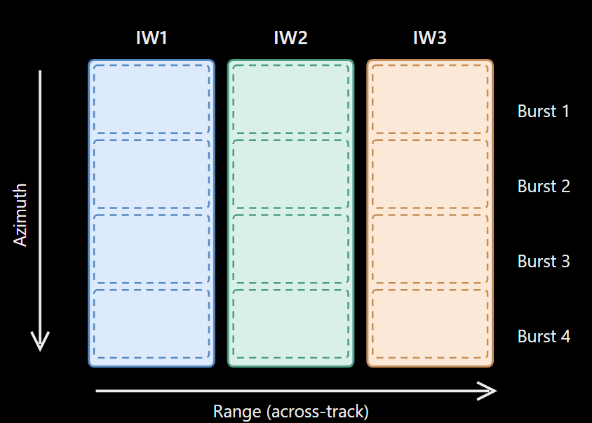
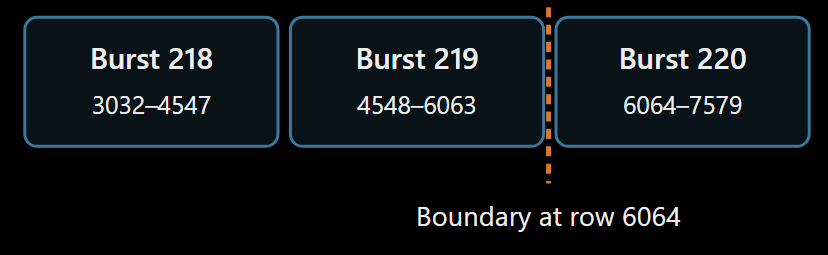
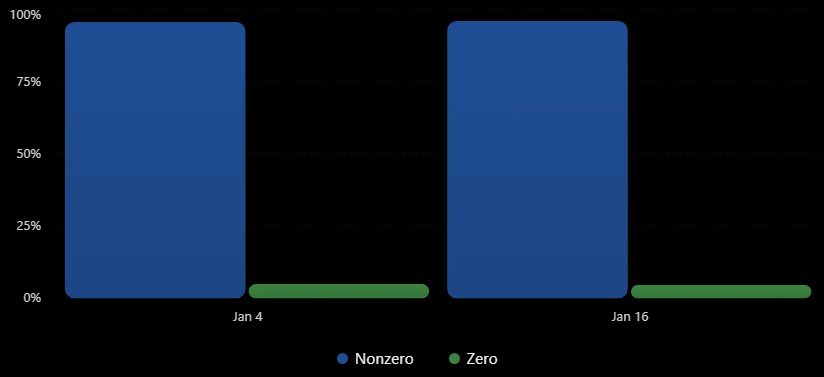

# ADR-011: InSAR validation

## Context

In this document explain the different validation doing with the annotation and the tiff file using the scrip *explore_sar_tiff.py*.


Add the path to the files:

```python
tiff_path_04_january = Path("data/raw/measurement/...")
annotation_path_04_january = Path("data/raw/annotation/...")
```

To run it:

```bash
pixi run -e dev python .\src\scrips\explore_sar_tiff.py
```

The validation/inspections are:
1. Validation of th tiff sctrucutre
2. Validation of burst structure
3. Validation of annotation-defined valid samples
4. Validation inside a burst
5. Validation across a burst boundary
6. Validation of zero-valued samples versus annotation validity
7. Comparison between January 4 and January 16

The purpose was to answer three questions:
1. Are the downloaded files structurally consistent with the expected Sentinel-1 SLC products?
2. Can we correctly identify which complex SAR samples are valid according to the annotation metadata?
3. Are the two acquisitions suitable candidates for the next processing stage, coregistration?


## 1. Validation of the TIFF structure

**Funtion**: inspect_metadata()

A Sentinel-1 SLC (Single Look Complex) image stores complex radar measurements. Each sample can be represented as:
$$
S=Ae^{i\phi}=I+iQ
$$

where $A$ is amplitude, $\phi$ is phase, and $I,Q$ are the real and imaginary components.
We inspected the TIFF metadata with Rasterio.

| Property |	January 4 |	January 16 |
| --- | --- | --- |
| Driver |	GTiff |	GTiff |
| Width |	25,286 |	25,286 |
| Height |	13,644 |	13,644 |
| Bands |	1 |	1 |
| Data  type |	complex_int16 |	complex_int16 |
| CRS |	None |	None |
| Transform |	Identity |	Identity |

### Why did we check these?
**Dimensions**: They tell us how many azimuth lines and range samples are stored. They also allow us to verify consistency with the annotation XML.

**Complex data type**: InSAR requires complex samples because phase differences are fundamental to interferometry. An amplitude-only raster would not be sufficient.

**CRS and transform**: Both TIFFs have no geographic CRS and an identity transform. This is expected for these radar-coordinate measurement images; their physical geometry is described through SAR metadata rather than a conventional map projection.

**Result**: Both TIFFs have compatible structural properties.
**Limitation**: Equal dimensions do not prove that their pixels correspond to the same geographic locations.

## 2. Validation of burst structure

**Function**: inspect_annotation()

Sentinel-1 IW SLC products use TOPS (Terrain Observation with Progressive Scans) acquisition mode, in which the instrument records data in bursts.



The annotation XML provides the burst organization.

|Property |	January 4 |	January 16|
| --- | --- | --- |
|Number of bursts |	9 |	9|
|Lines per burst |	1,516 |	1,516|
|Samples per burst |	25,286 |	25,286|

We verified:
$$
9\times1516=13644
$$

This matches the TIFF height exactly.

### Why is this important?

**Function**: 
The TIFF stores bursts sequentially along the azimuth dimension. We need to know where each burst begins and ends to interpret its samples correctly.

For example, using zero-based indexing:

| Burst index |	Global TIFF rows |
| --- | --- |
| 2 |	3032–4547 |
| 3 |	4548–6063 |
| 4 |	6064–7579 |

Our selected bursts 218, 219, and 220 correspond to indices 2, 3, and 4 in the burst mapping established during exploration.
Burst layout around the selected boundary



**Result**: The TIFF height and XML burst structure are consistent for both acquisitions.

**Limitation**: We have not yet fully compared burst timing, geolocation grids, and orbit geometry between acquisitions.

## 3. Validation of annotation-defined valid samples

This was the most important part of our investigation.

The annotation XML provides two arrays for each burst:
- firstValidSample
- lastValidSample

These specify the valid range samples for each azimuth line. A value of -1 indicates a line without valid samples.

We constructed a Boolean mask:
$$
M(r,c)=
\begin{cases}
1 & \text{if sample }(r,c)\text{ is annotation-valid}\\
0 & \text{otherwise}
\end{cases}
$$

For example:
```python
valid = (
    (first[:, None] >= 0)
    & (last[:, None] >= first[:, None])
    & (columns >= first[:, None])
    & (columns <= last[:, None])
)
```

## Why is this necessary?

The TIFF can contain stored complex values in regions that the product annotation identifies as invalid.

Without a mask, later algorithms could use samples that should be excluded from scientific processing.

## What did we observe?

Both acquisitions have approximately 90% annotation-valid pixels per burst.

For the two bursts around our investigated boundary:
|Burst |	January 4 valid pixels |	January 16 valid pixels |
| --- | ---- | --- |
|Index 3 |	34,608,464 |	34,608,464 |
|Index 4 |	34,584,792 |	34,584,792 |

Each burst contains:
$$
1516\times25286=38,333,576\text{ pixels}
$$

These statistics establish that the masks contain substantial valid coverage and are not simply empty arrays.

**Result**: We successfully extracted and applied the annotation validity information.

**Limitation**: Matching total valid-pixel counts does not establish identical spatial validity patterns.

## 4. Validation inside a burst

**Funtion**: compare_mask_with_tiff()

We selected a small window entirely within burst index 3:

```python
row_off = 5048
col_off = 12000
height = 256
width = 1024
```

The window contains:
$$
256\times1024=262144\text{ pixels}
$$

We compared the annotation mask with the complex TIFF values.

Each sample was classified into one of four categories.

| Classification |	January 4 |	January 16 |
|--- | --- | ---
| Valid + nonzero |	262,063 |	262,067 |
| Valid + zero |	81 |	77 |
| Invalid + nonzero |	0 |	0 |
| Invalid + zero |	0 |	0 |

### What does this demonstrate?

All pixels in this central window are annotation-valid.

A small number of those pixels have complex value zero. Therefore, a zero-valued sample is not automatically annotation-invalid either.

The four categories are exhaustive:
$$
N_{VN}+N_{VZ}+N_{IN}+N_{IZ}=N_{\text{total}}
$$

We checked this invariant in the code.

**Result**: The selected central window is fully annotation-valid, and the mask and TIFF windows have matching shapes.

## 5. Validation across a burst boundary

Next, we examined a window crossing the boundary between burst indices 3 and 4.
```python
row_off = 5950
col_off = 12000
height = 256
width = 1024
```

This covers global rows 5950–6205, crossing the boundary at row 6064.

The key complication was that the TIFF uses global row coordinates, while each burst's annotation mask uses burst-local row coordinates.

We used:
$$
b=\left\lfloor\frac{r}{1516}\right\rfloor
$$

$$
r_{\text{local}}=r\bmod1516
$$

where $r$ is the global TIFF row and $b$ is the zero-based burst index.

For example:
- Global row 6063 maps to burst index 3, local row 1515.
- Global row 6064 maps to burst index 4, local row 0.

## 6. Validation of zero-valued samples versus annotation validity

This experiment produced our most important scientific finding.

**Boundary-window results**

| Classification |	January 4 |	January 16 |
| --- | --- | --- |
| Valid + nonzero |	204,766 |	206,807 |
| Valid + zero |	34 |	41 |
| Invalid + nonzero |	54,741 |	52,961 |
| Invalid + zero |	2,603 |	2,335 |
| Total |	262,144 |	262,144 |

Nonzero values among annotation-invalid pixels

Percentages calculated within the invalid portion of each boundary window.



Approximately 95.5% of annotation-invalid samples have nonzero stored values in both boundary windows.

This means:
$$
S(r,c)\neq0 \;\not\Rightarrow\; M(r,c)=1
$$

*In words*: a nonzero complex SLC sample is not necessarily scientifically valid.

The reverse implication also fails in our central-window observations: some annotation-valid pixels contain zero values.

### Why does this matter for InSAR?
If we use slc != 0 as our validity mask, we would incorrectly include thousands of invalid samples near burst boundaries.

That could affect later calculations such as coherence estimation and interferometric phase analysis.

*Result*: We have direct evidence from both acquisitions that the annotation mask and the numerical zero mask represent different properties.

## 7. Comparison between January 4 and January 16

We also compared the validity statistics for the same radar-coordinate window.

| Metric |	January 4 |	January 16 |
| --- | --- | ---
| Valid pixels |	204,800 |	206,848 |
| Invalid pixels |	57,344 |	55,296 |
| Valid fraction |	78.13% |	78.91% |

The two acquisitions have similar validity coverage but not identical counts.

This is useful evidence that both datasets have comparable structure and that the masks are acquisition-specific.

### However, we must distinguish two levels of comparison:

*Structural comparison*: We can compare dimensions, burst counts, metadata, and validity statistics before coregistration.

*Physical pixel comparison*: We cannot assume pixel (r,c) in the reference and secondary images corresponds to the same ground scatterer before coregistration.

We have completed the first type, not the second.