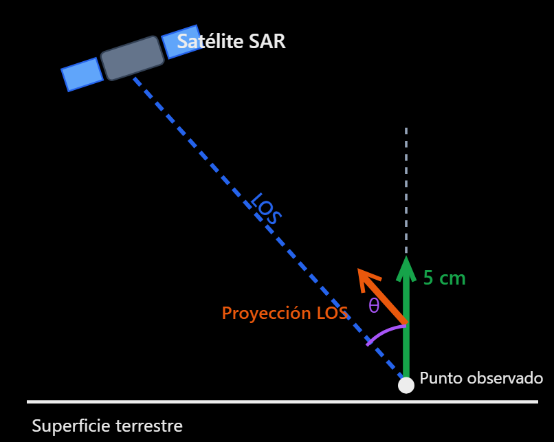
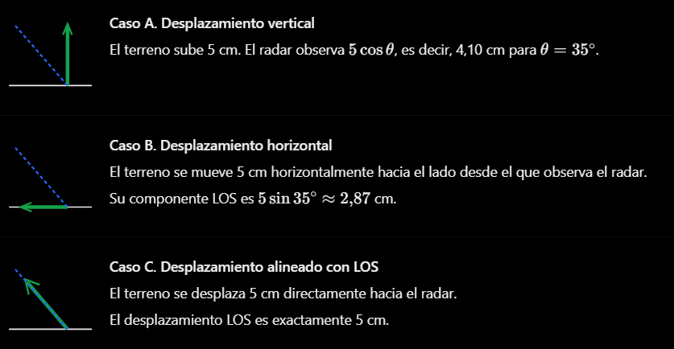
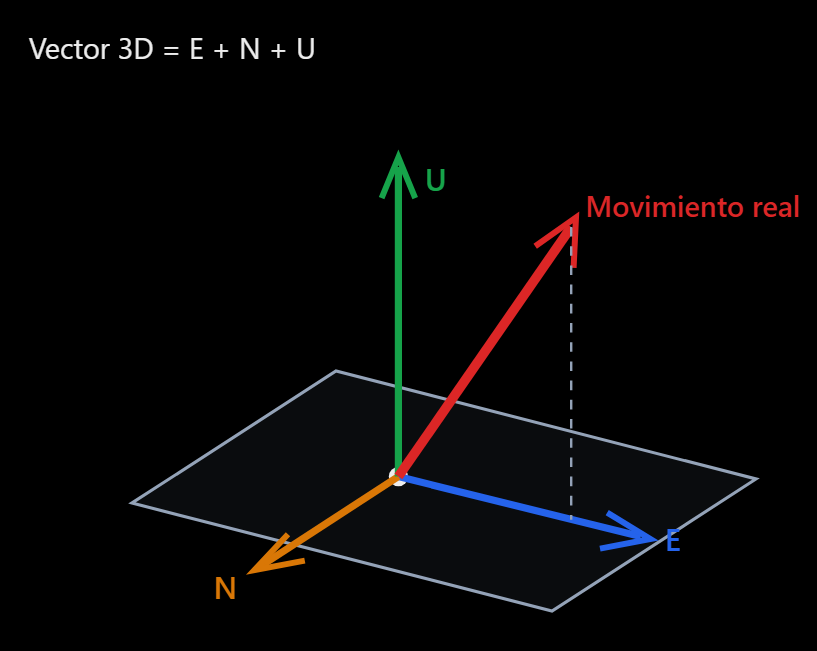

# InSAR Line-of-Sight Geometry and 3D Displacement Reconstruction

## 1. Why does InSAR not directly measure vertical displacement?

Synthetic Aperture Radar (SAR) observes the ground along its **line of sight (LOS)**. Interferometric SAR (InSAR) uses phase differences between compatible SAR acquisitions to estimate **changes in radar-to-ground distance**, after accounting for topographic, atmospheric, orbital, and noise contributions.

Because SAR generally looks sideways, actual ground motion is projected onto the LOS. Thus, a 5 cm vertical displacement usually produces an LOS measurement smaller than 5 cm in magnitude.

### 1.1. Diagram: projecting vertical motion onto LOS



> Schematic only, not to scale. We define positive LOS displacement as **toward the satellite** and use a unit LOS vector directed from the ground toward the satellite.

For **purely vertical** displacement:

$$
d_{\mathrm{LOS}}=d_U\cos\theta.
$$

Here $d_U>0$ means upward motion, and $\theta$ is the incidence angle from the local vertical.

**Example:** for $d_U=5\,\mathrm{cm}$ and $\theta=35^\circ$:

$$
d_{\mathrm{LOS}}=5\cos35^\circ\approx4.10\,\mathrm{cm}.
$$

The ground rose by 5 cm, but the radar observes only approximately **4.10 cm along LOS**.

### 1.2. What does the dot product mean?

The general relation is:

$$
\boxed{d_{\mathrm{LOS}}=\mathbf d\cdot\hat{\mathbf l}}
$$

- $\mathbf d$: the actual three-dimensional ground-displacement vector.
- $\hat{\mathbf l}$: a **unit vector** pointing from the ground toward the satellite.
- $d_{\mathrm{LOS}}$: the signed displacement component along LOS.

A dot product extracts the component of one vector along another:

$$
d_{\mathrm{LOS}}=\lVert\mathbf d\rVert\cos\alpha,
$$

where $\alpha$ is the angle between the displacement vector and the LOS unit vector.

In local **ENU (East, North, Up)** coordinates:

$$
\mathbf d=\begin{bmatrix}d_E\\d_N\\d_U\end{bmatrix},\qquad
\hat{\mathbf l}=\begin{bmatrix}l_E\\l_N\\l_U\end{bmatrix}.
$$

Therefore:

$$
\boxed{d_{\mathrm{LOS}}=l_Ed_E+l_Nd_N+l_Ud_U}.
$$

**InSAR responds to horizontal as well as vertical motion.** It does not measure uplift or subsidence alone.

### 1.3. Three illustrative cases



At $\theta=35^\circ$:

| Actual motion | LOS displacement magnitude |
|---|---:|
| 5 cm vertically upward | 4.10 cm |
| 5 cm horizontally toward the satellite, within the incidence plane | 2.87 cm |
| 5 cm directly toward the satellite | 5.00 cm |

The **sign** depends on whether the ground moves toward or away from the sensor. Motion perpendicular to LOS has zero LOS projection.

### 1.4. Can LOS displacement be converted into vertical displacement?

Only if there is a sound reason to assume $d_E=d_N=0$:

$$
\boxed{d_U=\frac{d_{\mathrm{LOS}}}{\cos\theta}}.
$$

For $d_{\mathrm{LOS}}=4\,\mathrm{cm}$ and $\theta=35^\circ$:

$$
d_U=\frac{4}{\cos35^\circ}\approx4.88\,\mathrm{cm}.
$$

**Caution:** if horizontal motion exists, treating LOS displacement as purely vertical can yield an incorrect result.

---

## 2. How is three-dimensional displacement reconstructed?

We want to estimate the three displacement components:

$$
\mathbf d=\begin{bmatrix}d_E\\d_N\\d_U\end{bmatrix}.
$$

Each interferometric LOS measurement supplies **one scalar projection** of this vector: one equation for three unknowns.

### 2.1. Ascending and descending observations

SAR satellites can observe the same area from ascending and descending passes. For right-looking SAR satellites in near-polar orbits, these passes generally have approximately opposite east–west sensitivities.



Each geometry provides a different observation:

$$
d_{\mathrm{LOS,A}}=\hat{\mathbf l}_A\cdot\mathbf d,
$$

$$
d_{\mathrm{LOS,D}}=\hat{\mathbf l}_D\cdot\mathbf d.
$$

**Two independent LOS observations do not uniquely determine three unknown displacement components.**

### 2.2. Recovering east–west and vertical displacement under an assumption

If north–south motion is negligible ($d_N\approx0$), and we use a simplified symmetric geometry with equal incidence angles $\theta$, then:

$$
d_{\mathrm{LOS,A}}=-d_E\sin\theta+d_U\cos\theta,
$$

$$
d_{\mathrm{LOS,D}}=+d_E\sin\theta+d_U\cos\theta.
$$

Adding and subtracting these equations gives:

$$
\boxed{d_U=\frac{d_{\mathrm{LOS,A}}+d_{\mathrm{LOS,D}}}{2\cos\theta}}
$$

$$
\boxed{d_E=\frac{d_{\mathrm{LOS,D}}-d_{\mathrm{LOS,A}}}{2\sin\theta}}.
$$

These are **teaching approximations**. Actual processing must use the LOS geometry of each observation.

**Worked example:**

- Ascending LOS displacement: $+3\,\mathrm{cm}$.
- Descending LOS displacement: $+5\,\mathrm{cm}$.
- Incidence angle: $35^\circ$.
- Assumption: $d_N=0$.

$$
d_U=\frac{3+5}{2\cos35^\circ}\approx+4.88\,\mathrm{cm},
$$

$$
d_E=\frac{5-3}{2\sin35^\circ}\approx+1.74\,\mathrm{cm}.
$$

Under these assumptions, the ground moved approximately **4.88 cm upward** and **1.74 cm eastward**.

### 2.3. What is needed to recover all three components?

At least three **linearly independent measurements** of the same displacement are needed, or equivalent additional constraints or observations.

For three LOS measurements:

$$
\underbrace{\begin{bmatrix}
d_{\mathrm{LOS},1}\\d_{\mathrm{LOS},2}\\d_{\mathrm{LOS},3}
\end{bmatrix}}_{\mathbf y}
=
\underbrace{\begin{bmatrix}
l_{E,1}&l_{N,1}&l_{U,1}\\
l_{E,2}&l_{N,2}&l_{U,2}\\
l_{E,3}&l_{N,3}&l_{U,3}
\end{bmatrix}}_{\mathbf A}
\underbrace{\begin{bmatrix}d_E\\d_N\\d_U\end{bmatrix}}_{\mathbf d}.
$$

In compact notation:

$$
\boxed{\mathbf y=\mathbf A\mathbf d}.
$$

If $\mathbf A$ has **rank 3**, all three components are identifiable in principle. However, even a full-rank matrix can be **ill-conditioned**, amplifying measurement noise.

Near-polar SAR orbits typically have weak sensitivity to north–south displacement. Consequently, north–south estimates may remain highly uncertain even with several LOS observations.

### 2.4. Ways to obtain additional information

| Method | Contribution | Limitation |
|---|---|---|
| Ascending + descending InSAR | Two LOS projections | Not enough for unconstrained 3D reconstruction |
| InSAR + GNSS | GNSS provides 3D displacement at measured points | GNSS stations may be sparse |
| InSAR + azimuth offsets | Adds along-track displacement sensitivity | Often less precise than interferometric phase |
| InSAR + MAI (Multiple Aperture Interferometry) | Provides additional azimuth displacement sensitivity | Accuracy depends on acquisition and processing |
| Multiple independent SAR geometries | Can provide a rank-3 observation system | Conditioning must still be assessed |

**MAI** exploits different azimuth subapertures to estimate motion in the satellite's along-track direction. This is useful because conventional LOS measurements from near-polar SAR satellites are relatively insensitive to north–south motion.

### 2.5. Solving an overdetermined system with least squares

With more independent observations than unknowns, weighted least squares can estimate the displacement vector:

$$
\boxed{\hat{\mathbf d}=(\mathbf A^T\mathbf W\mathbf A)^{-1}\mathbf A^T\mathbf W\mathbf y}.
$$

Here:

- $\mathbf A$: observation geometry matrix.
- $\mathbf y$: measured displacement projections.
- $\mathbf W$: weight matrix, usually reflecting observation uncertainty.
- $\hat{\mathbf d}$: estimated 3D displacement vector.

This closed-form expression requires an invertible normal matrix. In numerical implementations, QR or SVD is usually preferable, together with rank and conditioning checks. Regularization or physical constraints may be needed when observations do not sufficiently constrain all components.

All measurements must describe **compatible time intervals** and use consistent coordinate frames, LOS sign conventions, and displacement reference definitions.

### 2.6. Reconstruction workflow

```text
     Ascending InSAR            Descending InSAR
         LOS A                      LOS D
            \                        /
             +---- LOS geometry ----+
                        |
                Only two LOS?
                        |
              +---------+---------+
              |                   |
         Assume d_N≈0        Need full 3D
              |                   |
         Estimate E,U        Add independent
                             observations
                                  |
                            Build matrix A
                                  |
                           Solve y = A d
                                  |
                        Evaluate uncertainty
                                  |
                           Estimate E,N,U
```


