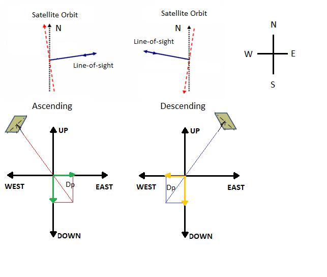
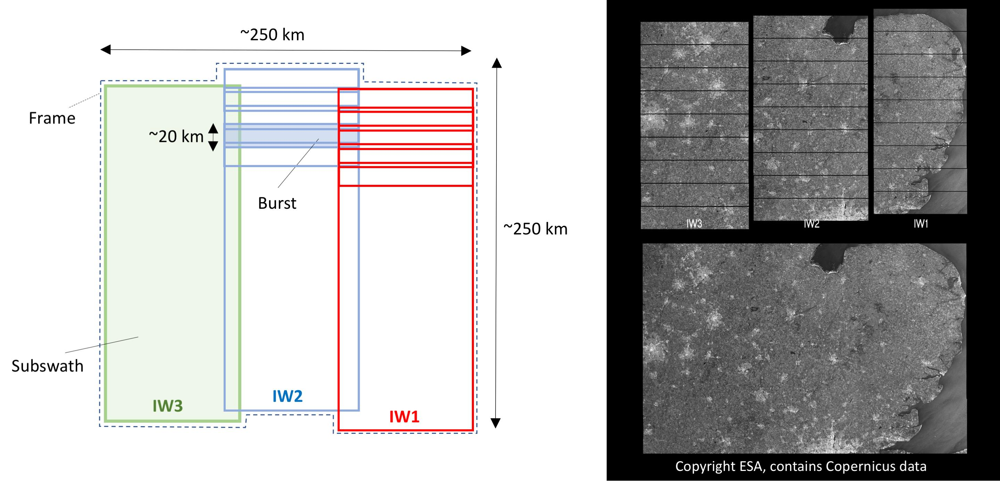
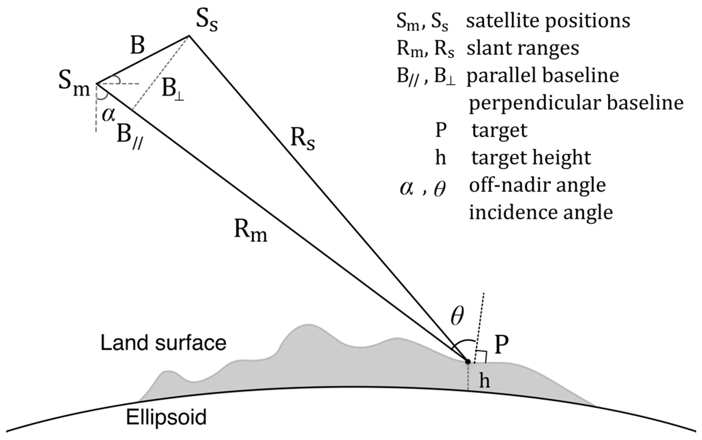
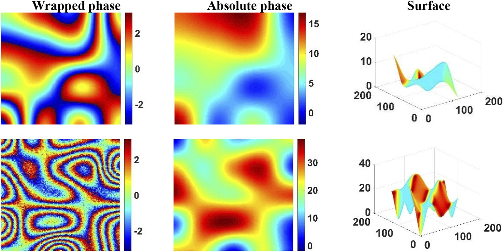

# Fundamentals of SAR Interferometry (InSAR)

Interferometric Synthetic Aperture Radar (InSAR) is a remote-sensing technique that uses phase differences between radar acquisitions to study terrain topography and surface displacement.

> **Image placeholder:** Overview of SAR acquisition and interferometric geometry.

## 1. Basic SAR concepts

### 1.1 Synthetic Aperture Radar (SAR)

SAR is an active sensor that transmits microwave pulses toward Earth's surface and records the backscattered signal. It operates during day and night and can image through most cloud cover.

A complex SAR image contains:

- **Amplitude:** related to the strength of the backscattered signal.
- **Phase:** related to the electromagnetic path length and scattering properties of the target.

The phase is essential for interferometry. Standard InSAR processing generally requires **Single Look Complex (SLC)** data, which preserve this information.

### 1.2 Line of Sight (LOS)

LOS is the direction connecting the radar and the observed target. InSAR measures the projection of displacement onto this direction, not the complete three-dimensional displacement vector.

$$
d_{\mathrm{LOS}} = \mathbf{d} \cdot \hat{\mathbf{l}} = d_E l_E + d_N l_N + d_U l_U
$$

where:

- $\mathbf d$ is the three-dimensional displacement vector.
- $\hat{\mathbf l}$ is a unit vector along LOS, with a specified sign convention.
- $d_{\mathrm{LOS}}$ is the projected displacement.
- $d_E$, $d_N$, and $d_U$ are east, north, and up displacement components; $l_E$, $l_N$, and $l_U$ are the corresponding LOS unit-vector components.

For example, a vertical displacement of 5 cm generally produces an LOS measurement with a magnitude smaller than 5 cm, because only its projection is observed.

**Important:** One LOS observation does not uniquely determine the three displacement components (east, north, up).

> **Image placeholder:** LOS geometry and projection of vertical and horizontal displacement.

### 1.3 Incidence angle

The incidence angle is the angle between the radar look direction and the local vertical of the reference surface. Smaller angles correspond to more nearly vertical observations; larger angles correspond to more oblique observations.

The incidence angle affects sensitivity to vertical and horizontal movement and influences radar geometric distortions.

### 1.4 Ascending and descending orbits

- **Ascending:** the satellite moves approximately south to north.
- **Descending:** the satellite moves approximately north to south.

For right-looking SAR systems such as Sentinel-1 in its usual acquisition modes, ascending and descending passes observe the surface from different directions. Combining both geometries can help estimate east–west and vertical displacement under additional assumptions, often neglecting or independently constraining north–south motion.

> **Image placeholder:** Ascending and descending satellite viewing geometries.

## 2. Swaths, bursts, and TOPS acquisition

### 2.1 Swath

A swath is a strip of terrain imaged during a radar acquisition. Sentinel-1 Interferometric Wide Swath (IW) mode consists of three subswaths: **IW1, IW2, and IW3**.

### 2.2 Burst

A burst is a time-limited radar acquisition segment covering part of a subswath. Consecutive bursts overlap to provide continuous coverage.

For TOPS interferometry, corresponding bursts must be acquired with compatible geometry and precisely coregistered. Small azimuth alignment errors can create significant phase artifacts.

### 2.3 Terrain Observation with Progressive Scans (TOPS)

TOPS electronically steers the antenna beam in azimuth during each burst. This enables wide coverage with relatively uniform radiometric performance, but requires particularly accurate azimuth coregistration.

> **Image placeholder:** Sentinel-1 IW subswaths, bursts, and TOPS beam steering.

## 3. Baseline

The **baseline** describes the separation between radar observation positions for two acquisitions.

### 3.1 Perpendicular baseline ($B_\perp$)

The component of spatial separation perpendicular to the radar LOS. It influences topographic phase sensitivity and geometric decorrelation. Excessively large perpendicular baselines may reduce interferometric coherence.

### 3.2 Parallel baseline ($B_\parallel$)

The component of spatial separation parallel to the radar LOS. It contributes to differences in radar path length and interferometric geometry.

### 3.3 Temporal baseline

The elapsed time between acquisitions. For example, observations on October 1 and October 13 have a temporal baseline of **12 days**.

Longer temporal baselines can increase decorrelation due to changes in vegetation, moisture, or scattering conditions. The effect depends on land cover and environmental conditions.

> **Image placeholder:** Perpendicular and parallel baselines between two satellite positions.

## 4. SAR interferometry

### 4.1 Interferogram

An interferogram is formed by multiplying two coregistered complex SAR images, one by the complex conjugate of the other:

$$
I=S_1 S_2^*
$$

where $S_1$ and $S_2$ are the complex acquisitions and $^*$ denotes complex conjugation.

The interferometric phase contains several contributions:

$$
\Delta\phi = \phi_{\mathrm{topo}}+\phi_{\mathrm{defo}}+\phi_{\mathrm{atm}}+\phi_{\mathrm{orb}}+\phi_{\mathrm{noise}}
$$

| Contribution | Meaning |
|---|---|
| $\phi_{\mathrm{topo}}$ | Phase caused by topographic geometry |
| $\phi_{\mathrm{defo}}$ | Phase associated with displacement between acquisitions |
| $\phi_{\mathrm{atm}}$ | Differential atmospheric propagation delays |
| $\phi_{\mathrm{orb}}$ | Residual orbit and geometry errors |
| $\phi_{\mathrm{noise}}$ | Noise and unmodeled effects |

### 4.2 Phase wrapping

Measured interferometric phase is represented modulo $2\pi$, usually within $[-\pi,\pi)$. A phase difference exceeding this range wraps back into it, producing interferometric fringes.

### 4.3 Phase unwrapping

Phase unwrapping attempts to recover a spatially continuous phase by estimating the missing integer multiples of $2\pi$. Errors can occur in low-coherence regions or where phase gradients are too steep.

> **Image placeholder:** Wrapped and unwrapped interferometric phase comparison.

### 4.4 Coherence

Interferometric coherence is the magnitude of normalized complex correlation between two SAR acquisitions. It ranges from 0 to 1.

| Coherence | Approximate interpretation |
|---|---|
| 0–0.3 | Low; phase often unreliable |
| 0.3–0.6 | Moderate |
| 0.6–0.8 | High |
| 0.8–1.0 | Very high |

These ranges are illustrative, not universal thresholds. Stable urban targets often retain high coherence, while water and changing vegetation frequently show low coherence.

## 5. From interferometric phase to ground displacement

After removing or correcting non-deformation contributions and unwrapping the phase, LOS displacement can be estimated using:

$$
d_{\mathrm{LOS}}=-\frac{\lambda}{4\pi}\Delta\phi_{\mathrm{defo}}
$$

This expression assumes a specific interferogram and LOS sign convention in which positive displacement is toward the satellite; reversing the convention reverses the sign.

- $\lambda$: radar wavelength.
- $\Delta\phi_{\mathrm{defo}}$: deformation-related interferometric phase.

Sentinel-1 has a wavelength of approximately **5.55 cm**. Therefore, a complete $2\pi$ phase cycle corresponds to approximately **2.78 cm of LOS displacement**, subject to phase ambiguity.

**Crucial limitation:** A single orbit/viewing geometry yields LOS displacement, not a unique three-dimensional displacement vector. Even ascending and descending LOS observations alone provide only two independent measurements for three unknown components; additional assumptions or measurements are needed.

## 6. Typical InSAR processing workflow

1. **Select two compatible SAR SLC acquisitions** with matching observation geometry and corresponding bursts.
2. **Coregister the images** with subpixel precision (especially important for TOPS).
3. **Generate the complex interferogram** and calculate its wrapped phase.
4. **Remove modeled topographic phase**, typically using a digital elevation model (DEM), to form a differential interferogram.
5. **Estimate coherence and filter the phase** to improve interpretability.
6. **Unwrap the phase** to recover a continuous phase field where possible.
7. **Apply atmospheric, orbital, and other relevant corrections**, according to the processing approach.
8. **Convert deformation phase to LOS displacement** and geocode the results as needed.

The precise order and available corrections depend on the processing software and workflow.

> **Image placeholder:** InSAR processing flowchart from SLC acquisitions to LOS displacement map.

## 7. Additional terminology

| Term | Definition |
|---|---|
| **SLC (Single Look Complex)** | Complex SAR product retaining amplitude and phase, used for conventional InSAR. |
| **GRD (Ground Range Detected)** | Detected, ground-range-projected product that does not preserve the complex phase required for conventional InSAR. |
| **Master / Slave** | Traditional terms for reference and secondary acquisitions. |
| **Coregistration** | Precise alignment of corresponding pixels between acquisitions. |
| **DEM (Digital Elevation Model)** | Elevation model used to simulate and remove topographic phase. |
| **DInSAR** | Differential InSAR, which seeks to isolate deformation-related phase. |
| **PS-InSAR** | Multitemporal analysis using persistent radar scatterers. |
| **SBAS** | Multitemporal approach combining interferograms with relatively small spatial and temporal baselines. |
| **Layover** | Radar geometric distortion in which returns from different terrain positions overlap in radar coordinates. |
| **Radar shadow** | Terrain region not directly illuminated by the radar due to obstructing topography. |
| **Decorrelation** | Loss of complex signal similarity between acquisitions. |
| **Multilooking** | Spatial averaging that reduces speckle/statistical noise, generally at the expense of spatial resolution. |

## 8. Key distinctions

- **SAR** records microwave backscatter from the Earth's surface.
- **InSAR** uses phase differences between SAR acquisitions to infer topography or displacement-related information.
- **DInSAR** attempts to isolate deformation by removing the modeled topographic phase and accounting for other contributions.
- **PS-InSAR and SBAS** exploit multiple acquisitions to estimate displacement histories and trends.
- **One viewing geometry** measures only the LOS component; it does not independently resolve full 3D motion.
